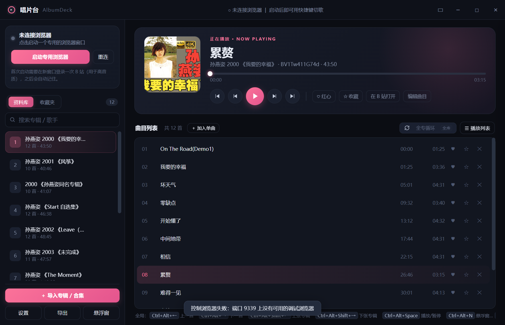
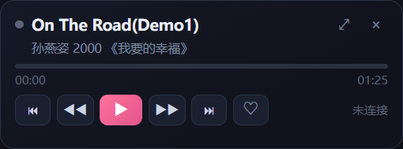

# AlbumDeck · 唱片台 <sub>v0.16</sub>

把 B 站的长视频（专辑 / 合集 / 演唱会）当成唱片来听：**时间戳点歌、切上一首下一首、切整张专辑、全局快捷键**，全部作用在你平常用的那个浏览器窗口里。

它**不是浏览器插件**，而是一个 Electron 桌面小工具：通过 Chrome DevTools Protocol（默认端口 9222）控制真实 Chrome / Edge 页面里的 `<video>` 元素，使用网页播放器播放，不影响登录态和音质。应用连接后会自动将 B 站的播放方式设为「播完暂停」，避免网页自动切集干扰应用队列。



[版本发布](https://github.com/kenaziuuu/AlbumDeck/releases) · [v0.16 更新说明](RELEASE_NOTES.md) · [♥ 支持作者](#支持作者)

---

## 目录

- [它解决什么问题](#它解决什么问题)
- [功能一览](#功能一览)
- [环境要求](#环境要求)
- [安装与启动](#安装与启动)
- [快速上手](#快速上手)
- [全局快捷键](#全局快捷键)
- [悬浮窗](#悬浮窗)
- [数据存放与备份](#数据存放与备份)
- [设置项说明](#设置项说明)
- [目录结构](#目录结构)
- [开发与自检](#开发与自检)
- [打包与上传 Git](#打包与上传-git)
- [已知限制](#已知限制)
- [版本记录](#版本记录)
- [支持作者](#支持作者)
- [许可](#许可)

---

## 它解决什么问题

一张「专辑」在 B 站上通常是一个几十分钟的长视频，曲目信息藏在置顶评论的时间戳里（`歌名 01:25`）。听的时候想切歌只能拖进度条，很痛苦。

AlbumDeck 做三件事：

1. **把长视频拆成曲目表**：自动读置顶评论时间戳 → 没有就用视频章节 → 再没有就整段当一首单曲。
2. **用桌面级操作控制播放**：全局快捷键切歌 / 切专辑 / 播放暂停，不用切回浏览器。
3. **把播放变成「专辑 + 曲目」的体验**：曲库、收藏夹、播放列表、悬浮窗，都围绕曲目而不是视频。

---

## 功能一览

### 曲库与播放

- 专辑列表：标题、曲目数、总时长；搜索框实时过滤
- 专辑拖拽排序（拖到列表上下边缘自动滚动）；右键 ⇅ 可按**歌名 / 年份 / 歌手**自动排序
- 曲目表：序号、歌名、起始时间、时长；点一下从该曲目开始播
- 七种播放方式：`专内单曲循环` / `专内循环播放` / `专内随机播放` / `全专循环播放`（默认）/ `专辑随机播放` / `全专歌曲随机` / `播完即停`
- 循环与随机方式会按各自范围持续接歌；单曲循环重播当前曲目；「播完即停」只播放当前曲目，结束后暂停，再按播放从本曲起点重播
- 应用每次启动连接 B 站后，自动将网页播放器的「自动切集」关闭，设为「播完暂停」，由唱片台接管曲尾动作；手动暂停、暂停时拖动进度或切换播放方式均保持暂停
- 默认优先使用 360P 视频，减少视频加载量；通过独立视频流切换保留当前音频选择，不支持独立切换时保留原画质
- 大曲库使用增量进度通信，隐藏窗口停止接收刷新；[性能与体积优化记录](docs/performance.md)
- 点歌后优先定位到所选曲目的起点：等待视频可定位并确认实际进度，短暂校验 B 站延迟恢复的历史位置；连续点歌以最后一次选择为准
- 播放列表抽屉：按专辑分组，当前专辑自动展开并定位；点任意曲目直接跳播
- 曲目可**隐藏**（播放时自动跳过），隐藏项变浅划线，点 ○ 恢复
- 设置里可关掉「点击资料库专辑时直接播放」：关掉后点专辑只切换查看，按播放键才开始播

### 导入

- 粘贴链接：视频 / 合集 / 系列 / UP 主空间，可一次勾选多个批量导入
- 三级回退识别曲目：**置顶评论时间戳 → 视频章节 → 整段视频当一首单曲**
- 粘贴纯文本时间戳（每行 `歌名 01:25`）手动建曲目表
- 关键词搜索视频
- 「＋ 导入到收藏夹」：导入的同时把曲目直接放进指定收藏夹（适合一堆单曲视频，不塞乱曲库）
- 曲库导入 / 导出 JSON（含收藏夹）

### 收藏夹

- 内置「喜欢」（不可删除），可新建**歌曲夹**与**专辑夹**
- ♥ 一键进「喜欢」；☆ 收藏到任意收藏夹（已在任意歌曲夹里就点亮成 ★，再点一次取消）
- **点单曲收藏夹里的歌 → 播放列表变成这个收藏夹**：只放这些歌，播完回到第一首；标题点一下退回整库
- **点专辑收藏夹里的专辑 → 就地展开曲目**：可直接 ♥ / ☆ / ✕（隐藏与曲库同步）；点曲目后，专内循环只播放这张专辑，最后一首播完回到本专辑第一首，全专模式则以该收藏夹为播放范围
- 收藏项 / 曲目 / 专辑都支持右键：查看来源（BV 号 + 起点）、在浏览器打开、复制链接、重新抓取曲目
- 收藏夹里的项即使专辑已从曲库删除，也能右键**重新导入并自动接回**

#### 收藏夹的播放范围

| 从哪里开始播放 | 播放方式 | 播放列表与实际播放范围 |
|---|---|---|
| 歌曲收藏夹中的一首歌 | 循环 / 随机 | 仅包含该收藏夹的歌曲，跳过所在视频中未收藏的曲目；播放完一轮后继续在夹内循环 |
| 歌曲收藏夹中的一首歌 | 专内单曲循环 | 重复播放所点的这首歌 |
| 任意收藏夹中的一首歌 | 播完即停 | 仅播放所点的这首歌，结束后暂停 |
| 专辑收藏夹中展开的一首歌 | 专内循环播放 | 仅包含这张专辑，最后一首结束后回到本专辑第一首 |
| 专辑收藏夹中展开的一首歌 | 专内随机播放 | 仅打乱这张专辑的歌曲，播放一轮后仍留在本专辑 |
| 专辑收藏夹中展开的一首歌 | 专内单曲循环 | 仅重复播放所点的这首歌 |
| 专辑收藏夹中展开的一首歌 | 全专循环 / 专辑随机 / 全专歌曲随机 | 以该收藏夹内的专辑为播放范围 |

在播放列表中点击收藏夹来源标题可退出收藏夹队列；切换播放方式后，列表会按新范围更新。隐藏曲目仍按「隐藏的曲目自动跳过」设置处理。

如果发现 B 站先跳到了下一视频，可在网页播放器设置中确认「播放方式 → 播完暂停」已选中。唱片台启动连接、点歌和换视频后都会自动确认这个选项；即使网页在原视频末尾抢先切集，应用也会优先按原队列接歌。

### 悬浮窗 / 托盘

- 三种悬浮窗样式：完整样式、简洁长条、MP3 样式
- 贴边自动收起、鼠标移到屏幕边缘滑出；隐藏后露出的边缘宽度可调（1~16px）
- ☆ 收藏 / ⟳ 播放顺序 / ☰ 播放列表都在**独立小弹窗**里操作，播放器卡片尺寸不变
- 自定义托盘菜单，悬停显示快捷键提示

---

## 环境要求

| 项目 | 要求 |
|---|---|
| 系统 | Windows 10 / 11（主要在 Windows 上开发验证） |
| 运行时 | Windows 便携版无需安装 Node.js；源码运行和打包需要 Node.js 18+ |
| 浏览器 | Chrome 或 Edge（会以调试端口 9222 启动一个独立窗口） |
| 账号 | B 站账号（首次在新窗口里登录一次，之后自动记住） |

> 首次启动的浏览器窗口用的是独立用户目录，不会影响你平时用的浏览器配置；但需要在里面登录一次 B 站（用于高音质播放）。

---

## 安装与启动

### 普通用户：下载 Windows 便携版

1. 打开 [GitHub Releases](https://github.com/kenaziuuu/AlbumDeck/releases)，下载附件 **`AlbumDeck-v0.16.0-windows-x64.zip`**。
2. 将**整个压缩包解压**到一个文件夹，保留 `resources/`、`locales/`、DLL 等全部文件。
3. 双击 **`AlbumDeck.exe`** 或 **`start.bat`** 启动，无需安装 Node.js，也无需运行 `npm install`。

GitHub 自动提供的 **`Source code (zip)`** 和仓库页面的 **`Download ZIP`** 是源码包，不包含 Electron 运行环境；运行源码请按下面的方法安装依赖。

### 开发者：从源码运行

先安装 Node.js 18+，再执行：

```bash
git clone https://github.com/kenaziuuu/AlbumDeck.git
cd AlbumDeck
npm install
```

启动方式二选一：

- **双击 `start.bat`**（推荐，会清掉宿主环境里的 `ELECTRON_RUN_AS_NODE`）
- 命令行 `npm start`

第一次使用：点界面左上角 **「启动专用浏览器」** → 在新窗口里登录 B 站 → 回到 AlbumDeck 会自动连接（状态变绿）。

**从旧版本升级：**从托盘菜单退出唱片台，完整解压新版便携包后启动；源码用户更新代码后运行 `npm install` 再启动。关闭主窗口会隐藏到托盘，需要完整退出后再启动才能加载新代码。曲库、收藏夹与设置保存在 `%APPDATA%\album-deck\album-deck.json`，升级前可复制该文件备份。

升级后由播放方式决定曲尾动作，旧的「切歌后自动播放」开关已移除，旧配置中的选择不再影响循环。应用每次启动连接 B 站后仍会自动关闭网页的「自动切集」。

### 启动时提示找不到 electron.exe

这说明 Electron 运行环境不在下载的目录中，通常是下载了源码 ZIP，或依赖安装未完成。

- 普通用户：下载上面的 **Windows 便携版附件**，完整解压后启动。
- 源码用户：在含 `package.json` 的目录执行 `npm install`；如果已安装依赖但仍缺少 `node_modules/electron/dist/electron.exe`，执行 `node node_modules/electron/install.js` 重新下载运行环境，然后再启动。

`start.bat` 会在缺少依赖时显示安装方法和便携版下载地址，避免直接尝试打开不存在的文件。

---

## 快速上手

1. **导入一张专辑**：点左下「＋ 导入专辑 / 合集」，粘贴 B 站视频 / 合集链接 → 解析 → 勾选 → 「抓取时间戳并导入」。
2. **播放**：点曲目即从该曲起点播放。默认点左侧专辑行也会播放；可在设置里关闭「点击资料库专辑时直接播放」，使点击专辑只切换查看。底部播放顺序按钮可切换七种方式，右键可直接选择。
3. **切歌**：`Ctrl+Alt+→` 下一首、`Ctrl+Alt+←` 上一首；`Ctrl+Alt+Shift+→` 下一张专辑。
4. **悬浮窗**：`Ctrl+Alt+N` 唤出，可拖到屏幕角落；拖到边缘会自动收起，鼠标移过去再滑出。
5. **收藏**：曲目行点 ♥ 进「喜欢」，点 ☆ 选其它收藏夹；之后在「收藏夹」页签里可以直接按收藏夹播放。

---

## 全局快捷键

默认值，可在「设置 → 全局快捷键」里改：

| 快捷键 | 作用 |
|---|---|
| `Ctrl + Alt + ←` / `→` | 上一首 / 下一首 |
| `Ctrl + Alt + Shift + ←` / `→` | 上一张 / 下一张专辑 |
| `Ctrl + Alt + Space` | 播放 / 暂停 |
| `Ctrl + Alt + R` | 重播当前曲目 |
| `Ctrl + Alt + M` | 显示 / 隐藏主窗口 |
| `Ctrl + Alt + N` | 开启 / 关闭悬浮窗 |

> 悬浮窗「开启 / 关闭」的语义：藏起来了（关掉或收起到边缘）→ 唤出并回到正常位置；正常显示中 → 直接关闭。

---

## 悬浮窗

| 样式 | 尺寸 | 内容 |
|---|---|---|
| 完整样式 | 340 × 126 | 歌名 / 专辑 / 进度 / 时间 + 全部按钮（含 ♡ ☆ ⟳ ☰） |
| 简洁长条 | 384 × 72 | 封面 + 歌名 / 专辑 + 控制 + 底部进度条 |
| MP3 样式 | 120 × 200 | 竖排：专辑 / 歌名 / 播放控制 / 专辑切换 / 功能按钮 |

- 拖到屏幕左 / 右 / 上边缘或拖出屏幕 → 0.6 秒后自动收起，只留一条边
- **隐藏后露出的边缘宽度**可在设置里调（1~16px，越大越明显），拖动即时生效
- 鼠标移到屏幕边缘的感应带即滑出
- ☆ / ⟳ / ☰ 弹出**独立小窗**，贴着播放器放，点别处 / × / Esc 收起，播放器本身不会被撑大



---

## 数据存放与备份

所有数据（专辑、曲目表、收藏夹、设置、窗口位置）都在一个 JSON 文件里：

```
%APPDATA%\album-deck\album-deck.json
```

- **导出**：主界面「导出」→ 保存一份含收藏夹的 JSON
- **导入**：同一入口选择 JSON 合并进来
- **备份**：直接复制上面那个文件即可；升级前建议复制一份
- 恢复示例曲库：设置里有「恢复示例曲库」（会替换当前曲库，注意先导出备份）

---

## 设置项说明

| 设置 | 说明 |
|---|---|
| 调试端口 | 默认 9222，与浏览器启动参数一致 |
| 浏览器路径 | 留空自动检测 Chrome / Edge |
| 优先使用 360P 视频 | 默认开启；仅调整独立视频流，保留当前音频选择。不支持独立切换时保留原画质；关闭后可在 B 站自行选择画质 |
| 点击资料库专辑时直接播放 | 关掉后点专辑只显示曲目，按播放键才开播 |
| 隐藏的曲目自动跳过 | 曲目表里 ✕ 隐藏的曲目播放时跳过 |
| 显示迷你悬浮窗 | 开启 / 关闭悬浮窗（等同于 `Ctrl+Alt+N`） |
| 贴边自动隐藏 | 拖到屏幕边缘是否自动收起 |
| 隐藏后露出的边缘 | 收起后留在屏幕边上的宽度，1~16px |
| 悬浮窗样式 | 完整样式 / 简洁长条 / MP3 样式 |
| 全局快捷键 | 8 个动作均可改键，支持恢复默认 |

曲尾动作由底部的播放方式决定：单曲循环重播本曲，其他循环和随机方式在各自范围内持续接歌，「播完即停」在当前曲目结束后暂停。手动暂停、暂停时拖动进度或切换方式均不会自动恢复播放。B 站网页保持「播完暂停」，避免抢先切集。

---

## 目录结构

```
AlbumDeck/
├─ .github/FUNDING.yml   GitHub Sponsor 按钮入口
├─ src/
│  ├─ main.js            主进程：窗口 / 托盘 / 全局快捷键 / 播放队列 / 全部 IPC
│  ├─ renderer.js        主界面逻辑：侧边栏、曲目表、收藏夹、播放列表、拖拽
│  ├─ index.html/css     主界面骨架与样式
│  ├─ preload.js         IPC 桥（window.deck.*）
│  ├─ bilibili.js        B 站接口：wbi 签名、合集 / 系列、评论、章节、时间戳解析
│  ├─ controller.js      CDP 控制器：seek / togglePlay / 读取播放状态
│  ├─ store.js           本地 JSON 存储与默认设置
│  ├─ playing.js         「正在播放」解析（纯函数）
│  ├─ poll-follow.js     轮询「跟随浏览器」的锁定逻辑（纯函数）
│  ├─ mini-geometry.js   悬浮窗尺寸 / 贴边 / 弹窗定位（纯函数）
│  ├─ sort-albums.js     专辑标题解析与排序（纯函数）
│  ├─ mini.html/css/js          悬浮窗三种样式
│  ├─ mini-pop.html/css/js      悬浮窗弹出面板（收藏夹 / 顺序 / 播放列表）
│  └─ tray.html/css/js          自定义托盘菜单
├─ tools/                启动器、自检脚本、图标与示例曲库生成
│  └─ pack-win.js         Windows 便携包生成与启动验证
├─ assets/               图标、示例曲库、界面截图
├─ start.bat             Windows 一键启动
├─ RELEASE_NOTES.md      当前版本的 GitHub Release 发布说明
└─ package.json
```

---

## 开发与自检

纯逻辑单测（不启动界面）：

```bash
npm run test:all      # 逻辑、播放、画质、增量通信和配置保存回归
npm run test:geo      # 悬浮窗尺寸 / 贴边收起 / 弹出面板定位
npm run test:playing  # 「正在播放」解析、曲尾判断
npm run test:queue    # 收藏夹实际连播、专内范围与曲尾循环（模拟浏览器，不启动应用）
npm run test:quality  # 独立切换 360P、音频保留与开关持久化
npm run test:performance # 增量状态、配置合并保存与发布资源策略
npm run bench:runtime # 300 张专辑 / 12000 首歌，隐藏窗口进度更新基准
npm run test:follow   # 轮询跟随的锁定逻辑
npm run test:sort     # 专辑标题解析 + 三种排序
npm run test:reorder  # 拖拽落点与索引修正
```

接口与浏览器自检：

```bash
npm run test:api      # B 站链接解析与搜索（需要联网）
npm run test:cdp      # CDP 控制链路（会起一个无头 Chrome）
npm run test:pause-cdp # 本地音频验证启动关闭自动切集、历史进度纠正与连续点歌
npm run test:quality-live # 真实 B 站页面对照视频分辨率与音频流（需要联网）
```

界面级自检（**使用隔离的 userData，不会动你的曲库**，跑完自动退出）：

```bash
npm run test:ui          # 悬浮窗面板：布局、收藏夹、播放列表、播放顺序
npm run test:folder      # 收藏夹队列 + 专辑收藏夹展开曲目
npm run test:mini-toggle # 悬浮窗「开启 / 关闭」与隐藏后露出宽度
npm run repro            # 把真实曲库复制进隔离目录启动，输出 state / DOM / 渲染错误
```

> `repro` 用于排查「界面空白但数据正常」这类问题：它会把主进程 snapshot、渲染进程 state、DOM 数量和 `window.__loadErr` 一起打印出来。

---

## 打包与上传 Git

仓库已带 `.gitignore`（忽略 `node_modules/`、自检产物、打包产物）。

**更新 GitHub 仓库：**

本次 GitHub 发布标签为 `v0.16`，`package.json` 与锁文件使用完整包版本号 `0.16.0`。创建发布前，先提交本地修改并推送到 `main`，确保标签指向包含本次修改的代码。

```bash
npm run test:all
npm run test:folder
npm run test:pause-cdp
git add .
git commit -m "Release v0.16: fix playback and optimize performance"
git push origin main
git tag -a v0.16 -m "AlbumDeck v0.16"
git push origin v0.16
```

在 [GitHub Releases](https://github.com/kenaziuuu/AlbumDeck/releases) 创建对应 `v0.16` 标签的版本，标题填写 `AlbumDeck v0.16`，发布说明使用 [RELEASE_NOTES.md](RELEASE_NOTES.md) 的内容。若通过网页新建标签，Target 选择已推送最新修改的 `main`。在页面底部的 **Attach binaries** 区域上传便携 ZIP 和对应 `.sha256` 文件，等待上传完成后，勾选 **Set as latest release**、不勾选 **This is a pre-release**，最后点击 **Publish release**。

**生成 Windows 便携包并上传 Release：**

普通用户请使用包含运行环境的便携包。发布者在 Windows 上安装依赖后运行：

```bash
npm run pack:win
```

输出为 `dist/AlbumDeck-v0.16.0-windows-x64.zip`、对应 `.sha256` 校验文件和 `dist/pack-report.json` 体积报告。打包保留全部运行 DLL、许可证及简体中文、繁体中文、英文语言资源，排除其他语言、默认示例和 README 预览图。包内 exe 会在隐藏窗口中验证主进程、预加载桥、设置和曲库渲染，并检查不同语言下启动；验证不使用开发机 PATH 中的 Node.js 或 npm，不连接用户正在使用的浏览器。

将生成的 **ZIP 文件上传到 GitHub Release 的附件**，供普通用户下载。`dist/` 和 `node_modules/` 继续由 `.gitignore` 排除，不提交到源码仓库。需要覆盖本地同版本打包产物时，运行 `npm run pack:win -- --force`。

GitHub 自动附带的源码包仍可供开发者下载，但必须先安装 Node.js 并运行 `npm install`。

> 便携版包含可直接运行的 `AlbumDeck.exe`，不需要安装向导；必须保留解压目录中的全部运行文件。

---

## 已知限制

- 主要针对 Windows 开发与验证，macOS / Linux 未测试
- 依赖 B 站网页结构与置顶评论格式；B 站改版可能影响曲目识别
- 需要浏览器以调试端口 9222 启动（由应用负责启动，不要手动用同一个用户目录开第二个窗口）
- 程序未做代码签名，首次运行可能被 SmartScreen 拦截
- 单实例运行：重复启动会唤起已有窗口
- 「正在播放」的曲目定位依赖播放进度，曲目边界处可能有 1 秒内的偏差

---

## 版本记录

### v0.16 — 2026-11-13

- 优化大曲库通信与刷新：进度更新不再重复传输曲库，隐藏窗口停止接收刷新，恢复显示时同步最新状态
- 缓存收藏和专辑索引，合并同一轮消息与悬浮窗位置保存，避免重复写盘和重叠轮询；关闭悬浮窗时不在启动阶段创建其窗口
- 精简便携包中的语言资源、默认示例与预览图，保留运行库和许可证；生成体积报告并使用流式 SHA256 校验
- 新增默认开启的「优先使用 360P 视频（保留当前音质）」设置，仅调整独立视频流；不支持时保留原画质
- 修复专内循环在 B 站视频结束后回到第一首却仍暂停的问题；循环和三种随机方式按各自范围持续接歌
- 修复跳回第一首后被网页延迟再次暂停的问题：同步 B 站播放器状态并确认持续播放；接管期间手动暂停仍优先
- 新增「播完即停」：仅播放当前曲目，结束后暂停，再按播放从本曲起点重播
- 移除「切歌后自动播放」设置与旧配置影响；明确区分自然结束与手动暂停，暂停时拖动进度和切换方式均保持暂停

### v0.15 — 2026-11-12

- 新增 Windows 64 位便携包，包含完整 Electron 运行环境和生产依赖，普通用户无需安装 Node.js 或运行 `npm install`
- 修复源码包直接运行 `start.bat` 时弹出找不到 `electron.exe` 的问题：缺少依赖时显示安装方法和便携版下载地址
- 启动脚本同时支持便携目录中的 `AlbumDeck.exe` 和源码目录中的 Electron 运行时
- 新增 `npm run pack:win`，自动打包并验证包内程序、主页面和预加载桥，生成 ZIP 与 SHA256 校验文件
- 更新下载、升级和 GitHub Release 发布说明，明确区分便携版附件与 GitHub 自动生成的源码 ZIP

### v0.13 — 2026-11-12

修复 B 站自动切集与历史进度恢复对应用播放控制的干扰：

- 默认设置：「切歌后自动播放」默认不勾选；升级保留已保存的选择
- 启动连接：应用每次启动连接 B 站后，自动关闭网页「自动切集」，设为「播完暂停」；控件延迟加载、重连或换视频后继续自动确认，无需先点歌
- 曲尾接歌：网页在原视频末尾抢先换视频时，应用先按原队列推进，避免专内循环被带到下一张专辑；整段视频的末曲等待原生结束或末尾暂停，不提前截掉最后两秒
- 点歌定位：等待媒体可定位并确认实际进度；点歌完成后校验 10 秒内的异常跳转，纠正 B 站历史记录覆盖所选曲目的情况
- 连续点歌：以最后一次选择为准，旧导航和定位请求不会覆盖新选择；慢加载和页面切换中的旧轮询不改动目标队列
- 播放回归测试扩充至 28 项；真实浏览器自检覆盖启动、重连、控件延迟加载、曲尾暂停、历史进度纠正与连续跨专辑点歌
- 完善「支持作者」：README 展示微信 / 支付宝收款二维码，仓库 Sponsor 按钮跳转到赞助区

验证：`npm run test:all`、`npm run test:cdp`、`npm run test:pause-cdp`、`npm run test:folder`。完整发布说明见 [RELEASE_NOTES.md](RELEASE_NOTES.md)。

### v0.12 — 2026-11-12

修复收藏夹的播放范围与实际连播不一致的问题：

- 歌曲收藏夹：一首歌结束后跳到下一首收藏歌曲，不再沿长视频继续播放未收藏的歌曲；夹内最后一首结束后回到第一首
- 专辑收藏夹：专内循环只显示并播放所点专辑，最后一首结束后自动回到该专辑第一首；专内随机也限制在同一张专辑内
- 播放方式切换后同步重建收藏夹队列；仅查看另一张专辑时，当前播放范围保持不变
- 单曲循环按实际队列重复播放，修正同一专辑改点另一首后队列未同步的问题
- 新增收藏夹播放回归测试，覆盖自动曲尾、跨专辑收藏歌曲、末曲循环、隐藏曲目跳过、模式切换与浏览器进度接入
- 更新 GitHub 发布与升级说明，添加「支持作者」入口

### v0.1.0 — 2026-11-12

首个可用版本：

- 曲库：专辑 / 曲目表管理、拖拽排序、按歌名 / 年份 / 歌手自动排序、隐藏曲目
- 导入：视频 / 合集 / 系列 / UP 主空间批量导入，评论时间戳 → 视频章节 → 单曲三级回退；导入到收藏夹
- 播放：六种播放顺序、播放列表抽屉、曲尾自动接歌、跨专辑循环
- 收藏夹：歌曲夹 / 专辑夹、红心、☆ 多夹收藏、收藏夹队列、专辑收藏夹就地展开曲目
- 悬浮窗：三种样式、贴边自动收起、可调露出宽度、独立弹出面板
- 托盘：自定义窄菜单 + 快捷键提示
- 全局快捷键：8 个动作可自定义
- 其他：CDP 控制真实浏览器、JSON 导入导出、开机自恢复窗口位置

---

## 支持作者

如果唱片台让你听专辑更方便，欢迎请作者喝杯咖啡，支持后续开发和维护。软件免费开源，赞助完全自愿，感谢你的支持。

| 微信 | 支付宝 |
|:---:|:---:|
|  |  |

也欢迎通过 [GitHub Issues](https://github.com/kenaziuuu/AlbumDeck/issues) 反馈问题和建议。

---

## 许可

[MIT](LICENSE)
